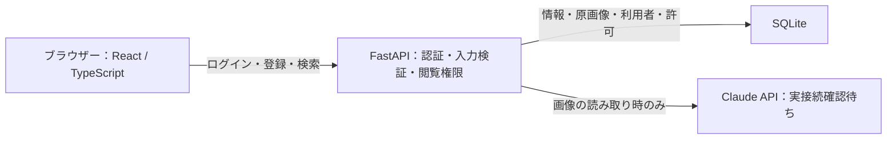

# 実装判断と機能の説明

この資料は、名刺ノートの実際のコードを説明するための資料です。要件は[仕様書](SPEC.md)、APIの入出力は[API仕様](API.md)、実施した確認は[検証記録](VERIFICATION.md)に分けています。

## 1. 全体の構成



ブラウザーは表示と入力を担当し、保存・権限の最終判断をFastAPIで行います。画面上の管理メニューを隠すだけでは、不正なAPI呼び出しを防げないためです。保存処理はAIから独立しており、キーが使えない状態でも手入力で名刺を登録できます。

プログラミング言語は**TypeScriptとPython**です。ReactとFastAPIはフレームワーク／ライブラリ、SQLiteはデータベースです。見た目にはHTML・CSSも使っています。

## 2. 採用した方式と代替案

| 判断した点 | 採用した方式 | 他の選択肢 | 採用理由・制約 |
| --- | --- | --- | --- |
| 画面とAPI | React＋TypeScript、FastAPI＋Python | Next.jsへの集約、PythonによるHTML生成 | 利用経験があり、画面操作と認証・AI・DBを分担しやすい。2言語の管理は必要 |
| 画面のビルド | Vite、URLのハッシュで画面切替 | Next.jsや専用ルーター | 5画面のローカルアプリで、SSRや複雑なルーティングが不要 |
| データベース | SQLite＋SQLModel | PostgreSQLなど別DBサーバー | 90分の課題でセットアップと再現性を優先。大規模な同時書き込みには向かない |
| 原画像の保存 | SQLiteのBLOB | ローカル画像フォルダー、オブジェクトストレージ | 情報と画像をまとめて保存・取り消しできる。DBが画像の分だけ大きくなる |
| 認証 | Argon2＋DB管理セッションCookie | JWT、外部認証サービス | ログアウト時にセッションを直ちに無効化しやすい。APIごとにDBの確認が必要 |
| 利用者登録 | adminがメールと初期パスワードを指定 | 自己登録、招待メール | 「登録済み利用者だけ利用可」と時間制限に合わせた。メール送信やパスワード再設定は範囲外 |
| 閲覧制御 | DB検索時に共通の許可条件を適用 | APIごとの個別実装 | 一覧だけ保護して画像が漏れる、といった経路ごとの差を防ぐ |
| 企業・部署・人物の特定 | IDを使用。部署は企業別、人物は明示的に紐付け | 名前の一致による自動統合 | 同名部署・同姓同名への誤共有を防ぐ。企業名の表記揺れは自動吸収しない |
| 抽出と保存 | 別API | 抽出直後に自動保存 | ユーザーが原画像を見て修正してから確定する。保存再試行にAI料金が発生しない |
| 二重登録の防止 | 利用者＋request_idの一意制約 | 保存ボタンの無効化だけ | 通信失敗による再送も扱う。同じ人物の別の名刺を禁止する重複判定ではない |
| 画像形式 | JPEG・PNG、5MiB・2,000万画素まで | 多数の形式を受け入れる | 制限を明示し、破損や巨大画像を検証できる範囲に絞る |
| 起動とテスト | 実起動をasgi.pyに分離 | テスト用フラグで起動処理を抑止 | importだけで実.envや通常DBを開かない。フラグの付け忘れを避けられる |
| 期限切れの復帰 | 再ログイン中は入力を保持し、同じ利用者なら続行 | ログイン画面へ遷移して入力を破棄 | 保存失敗で修正内容を失わない。別利用者へ入力を持ち越さない |
| 画像の差し替え | 入力をクリア／保持を利用者が選択 | 常にクリア、常に保持 | 別の名刺と、同じ名刺の撮り直しを区別する。これは利用者の回答で確定した仕様 |

## 3. ログイン・ログアウト

実装の中心は `backend/app/main.py` の `login`、`authenticate`、`mutation` と、画面の `Login` です。

1. メールの前後空白を除き、小文字へ統一して利用者を検索します。
2. 入力パスワードを、DBに保存したArgon2のハッシュと照合します。パスワードの平文は保存しません。
3. 成功するとランダムなセッショントークンをCookieへ設定します。DBにはトークンそのものではなくハッシュを保存します。
4. 次のAPIアクセスでは、CookieのトークンからDBのセッション・有効期限・利用者を確認します。
5. ログアウトではDBのセッションとCookieを失効させます。

CookieはHttpOnlyなので通常のJavaScriptからは読み取れません。更新操作には、送信元Originと、セッションに紐付くCSRFトークンも確認します。これは、別サイトから意図しない登録・権限変更を送らせる攻撃への対策です。

初期adminは、利用者が0件のときだけ環境変数から作成します。再起動で既存のパスワードやroleを書き換えません。有効期間は初期値8時間です。

期限切れのAPI応答は401です。画面で再ログインし、同じ利用者なら選択画像・修正内容・保存リクエストIDを保持して再試行します。失敗した保存を勝手に再送はしません。明示的なログアウトや別利用者への切り替えでは入力を破棄します。

## 4. 名刺の取り込み・確認・保存

画面の `Registration`、APIの `validated_image` と `save_card` が担当します。

対象は次の8項目です。

| 項目 | 条件 |
| --- | --- |
| 氏名 | 必須、前後空白を除いて1〜200文字 |
| 会社名・部署・役職・メール・電話・住所・Webサイト | 任意、それぞれ最大1,000文字 |

画像はブラウザーでプレビューします。ファイル名やMIMEの申告を信用せず、サーバーでデコードしてJPEG/PNGか、破損していないか、容量・画素数が上限内かを検証します。

AIを実行した場合も、この段階ではDBへ名刺を登録しません。利用者が内容を確認・修正して保存を押すと、確定した8項目と元画像をまとめて送ります。バックエンドは再検証し、企業・部署・人物のIDと登録者を決めて、1回のトランザクションで保存します。

**トランザクション**は、途中までの保存が残らないように処理を一まとまりにする仕組みです。例えばDB保存が失敗した場合に「名刺情報はあるが原画像がない」という状態を避けます。

登録者IDは送信フォームから受け取らず、ログイン中の利用者から設定します。`created_by` や `role` など、受け付けない項目を送っても拒否します。

画像の差し替えでは、次のいずれかを選びます。

- **別の名刺**：前の8項目と人物の紐付けをクリアして新しい画像を使います。
- **同じ名刺の撮り直し**：8項目と人物の紐付けを保ったまま画像を変えます。
- **キャンセル**：現在の画像と入力を保ちます。

対応外の画像を選んだ場合も、編集中の画像・情報を失わないようにします。

## 5. AI読み取り

`backend/app/ai.py` の `extract_fields` が担当します。接続実装はありますが、提供キーの認証問題により実際の読み取りは未確認です。この資料作成・改善作業では実APIを呼び出していません。

- APIキーとモデルIDをサーバーだけで読みます。
- 読み取り用の画像は必要に応じて縮小しますが、保存する原画像は変更しません。
- Claudeに8項目の構造を指定し、未記載・判読不能は空文字にするよう指示します。画像内の命令文は抽出指示として扱いません。
- 返ってきた内容をPydanticで検証し、項目不足、余計な項目、長すぎる文字列などを成功として返しません。
- 認証・回数制限・タイムアウトなどは利用者向けのエラーへ変換し、キーや生の外部API応答をブラウザーへ出しません。

形式の検証は、読み取り内容が正しいことの保証ではありません。原画像との照合と、提供された期待値での確認が別途必要です。

## 6. 一覧・検索・詳細・元画像

画面の `CardList` と `Detail`、APIの `list_cards` と `find_card` が担当します。

- 氏名または会社名の部分一致で検索します。
- 検索条件と閲覧権限を両方DBに適用し、許可された件数とデータだけを返します。
- 新しい名刺から並べ、画面では12件ずつ表示します。
- 一覧では大きな画像BLOBを読み込まないようにします。
- 詳細で8項目、登録者、登録日時、元画像を表示します。

画像は公開フォルダーに置いていません。`/api/cards/{id}/image` にも同じ閲覧判定を適用します。権限がないIDと存在しないIDは同じ404を返すため、「名刺が存在するか」だけを探ることも抑えます。

## 7. 利用者・閲覧許可の管理

画面の `Admin` と `/api/admin/...` が担当します。

管理者はメールと初期パスワードでuserを追加し、対象の利用者へ企業・部署・人物単位の許可を付与・解除できます。入力からadmin権限を指定することはできません。管理画面を隠すだけでなく、バックエンドでもadminか確認します。

名刺を見られる条件は次のORです。

```text
adminである
または、自分が登録した名刺
または、企業IDへの許可がある
または、部署IDへの許可がある
または、人物IDへの許可がある
```

例として、A社全体の許可とA社営業部の許可がある場合、企業の許可を解除しても営業部の名刺は見られます。最後の許可が消えれば、次の一覧・詳細・画像取得から拒否されます。自分が登録した名刺への権限は残ります。

同じ「営業部」でもA社とB社は別の部署IDです。同じ氏名でも、通常は別の人物IDです。既存人物の選択は、閲覧できる名刺に紐付いた候補に限り、サーバーでも確認します。

権限一覧の取得に失敗した場合は「許可が0件」とは表示せず、取得失敗と再試行を示します。通信できていない状態と、本当に設定がない状態を区別するためです。

## 8. 保存失敗と二重登録

保存中はボタンを無効にします。ただし、ボタン制御だけでは「サーバーで保存できたが応答が届かなかった」場合の二重登録を防げません。

そこで画面が保存リクエストIDを作り、バックエンドは `登録者ID + request_id` を一意にしています。同じID・同じ内容の再送なら既存の結果を返します。同じIDで別内容なら409として拒否し、以前の名刺を上書きしません。別利用者が同じIDを使っても、その利用者の範囲で扱います。

画像や入力を編集した場合は新しいリクエストIDにします。AI失敗・保存失敗では、そのままの入力で再試行できるよう、画像と修正内容を画面のメモリーに保持します。ブラウザーを閉じたり再読み込みした後まで残る下書き保存機能はありません。

## 9. ファイルを読む順序

| ファイル | 役割 |
| --- | --- |
| `frontend/src/App.tsx` | Login、Registration、CardList、Detail、Adminと画面全体の状態 |
| `frontend/src/main.tsx` | Reactをブラウザーへ描画する入口 |
| `backend/app/asgi.py` | 実起動時だけ.envを読み、アプリを生成 |
| `backend/app/main.py` | アプリ生成、認証、共通の閲覧条件、各API |
| `backend/app/schemas.py` | APIで受け付ける入力の型・必須項目・長さ |
| `backend/app/models.py` | 利用者、セッション、企業、部署、人物、名刺、許可のDB構造 |
| `backend/app/ai.py` | Claudeへの画像送信と抽出結果の検証 |
| `backend/tests/` | API・権限・永続化・AIモック・起動分離の検証 |
| `frontend/src/` のテスト | 実際の画面操作と失敗からの復帰を模擬する検証 |

まずRegistrationから保存APIを追い、次に `visible_cards` を一覧・詳細・画像から追うと、中心となる処理を説明できます。

## 10. 面接などで短く説明する例

「ReactとTypeScriptで名刺の登録・検索・管理画面を作り、FastAPIとPythonで認証、AI読み取り、入力検証、閲覧制御を実装しました。元画像と確認済みの情報はSQLiteに一括保存します。企業・部署・人物の権限はOR条件にし、一覧だけでなく画像の取得にも同じ条件を適用しました。AIの結果は人が修正してから保存する流れにしています。権限の境界や失敗からの再試行を自動テストとブラウザーで確認し、実API未確認の範囲は区別して記録しています。」

生成AIを活用した実装であり、自分で説明できる範囲に合わせて表現してください。

## 画面デザインとパスワード表示（2026-10-23追記）

ログインのパスワード欄右端に目のボタンを設け、クリックするたびに表示と非表示を切り替えます。初期状態は非表示です。入力値は同じReactのstateに保持し、inputのtypeだけを変更するため、確認のための切り替えで内容は消えません。ボタンはtype=buttonなのでログイン送信を起こさず、Tabで選択してSpace・Enterでも操作できます。状態に合わせた日本語の読み上げラベルとaria-pressedを設定しています。

全画面の配色を生成り・墨色・落ち着いた緑に揃え、強調に茶色を使います。英語の飾り見出しを外し、サイドバーと画面上部に日本語の操作名・現在位置・権限を表示します。名刺一覧は氏名、会社・部署、連絡先を比較しやすい行形式に変更し、狭い画面では縦方向へ並べ替えます。ログイン画面の名刺の図はCSSで描き、追加の画像配信や依存ライブラリは使いません。
